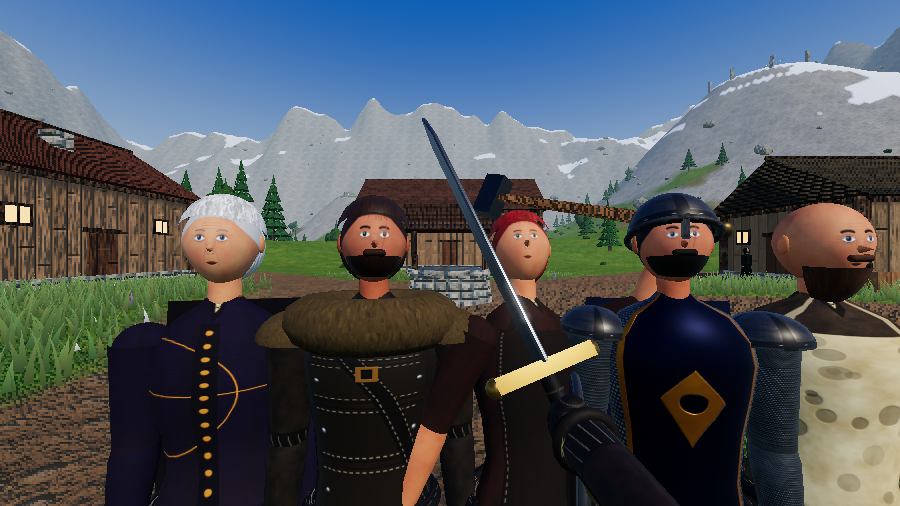

# Ashvale: The Dragon of Frostspire

A first-person fantasy RPG in the spirit of Skyrim that runs entirely in the browser. You explore a valley, take quests from villagers, level up eight skills and their perk trees, learn a Shout, and hunt the dragon Vyrmathax.



**Play:** `(https://pilotd98.github.io/Ashvale/)` 


Saves are stored in each player's browser for your Pages address. The game needs a keyboard and mouse. Loading takes a few seconds while textures are generated.

Slow computer? Switch **Graphics: Low** on the title screen, or add `?quality=low` to the address.

## Controls

| Key | Action | Key | Action |
|---|---|---|---|
| W A S D | Move | Left click | Attack (hold for a power attack) |
| Mouse | Look | Right click | Block |
| Shift | Sprint | 1 – 8 | Hotbar spells & powers |
| Space | Jump | Z | Shout (Unrelenting Force) |
| C / Ctrl | Sneak | Q / R | Health / magicka potion |
| E | Talk / loot / open / use | K | Skills & perk trees |
| P | Magic & hotbar setup | I or Tab | Inventory |
| J | Quests | M | Map |
| Esc | Pause menu | F5 | Quick save |

## Skills & perks (Skyrim-style)

Eight skills improve **by using them**. Each skill increase earns character XP, and every character level gives a perk point plus +10 Health, Magicka or Stamina.

| Skill | Improves by | Active perks (hotbar powers) | Passive perks (examples) |
|---|---|---|---|
| One-Handed | landing melee hits | Whirlwind Strike | Armsman, Bladesman crits, Savage/Paralyzing power attacks |
| Block | blocking attacks | Shield Bash | Deflect Arrows, Riposte, Block Runner |
| Heavy Armor | getting hit in plate | Iron Will | Juggernaut, Conditioning, Reflect Blows |
| Light Armor | getting hit in leather or scale | Evasive Roll | Agile Defender, Wind Walker, Deft Movement |
| Destruction | spell damage | Fireball, Chain Lightning | Augmented Flames/Frost/Shock, Deep Freeze, Impact |
| Restoration | healing | Ward, Turn Undead, Grand Healing | Regeneration, Respite, Recovery, Avoid Death |
| Sneak | sneaking near enemies, sneak attacks | Shadow Cloak | Stealth, Backstab (4×), Assassin's Blade (6×), Shadow Warrior |
| Speech | buying and selling | Intimidate | Haggling, Persuasion, Merchant, Master Trader |

Perk trees are drawn as constellations (**K**). Diamonds are active abilities and circles are passives. Each perk needs a minimum skill level and an earlier perk in its tree.
Trainers in Ashvale teach skills for gold (5 sessions per level): Brenna, Captain Rolf, Old Hilde, Torvald and Ysolde.

## What's in it

- **World:** a 600×600 valley with forests, lakes, causeway roads, snowy peaks, a walled village and a day/night cycle
- **Graphics:** textured terrain that blends grass, dirt, rock, sand and snow; wind-blown grass; textured timber, stone and shingle buildings; physically based lighting with sky reflections; shadows, bloom, clouds and stars. Every texture is generated in code, so the game ships no image files
- **Characters:** skinned bodies that bend smoothly at every joint; sculpted heads (brow, sockets, cheekbones, nose, lips, jaw) with glossy eyeballs and blinking eyelids; skin with pores, natural flush and age lines; strand-card hair and beards; hands with fingers; fabric with sheen, stitched leather, chainmail, plate, fur, helmets, hoods and draugr wrappings
- **Animation:** jointed bodies (knees, elbows, spine) with walk/run cycles, combat stances, attacks with wind-up, strike and follow-through, hit flinches, staggers and collapsing deaths; first-person 3-hit sword combos, charged power attacks, hit-stop and screen shake
- **9 locations to discover:** Ashvale, Redfang Camp, Hollowmere Barrow, Windward Shrine, Frostspire Summit, the Guardian Stones, Silverpine Lake, the Old Watchtower, Hunter's Cabin
- **Main quest:** *The Dragon of Frostspire* (7 stages, ending in a dragon fight)
- **Side quests:** *The Wolf Problem*, *Family Heirloom*, *Frostbloom Harvest*, *Bandits at the Watchtower*
- **Combat:** light and power attacks, blocking, sneak attacks, 9 spells and 6 powers on an 8-slot hotbar, and a Shout that staggers enemies and pulls the dragon out of the sky
- **Enemies:** wolves, bears, bandits, bandit archers, draugr, and bosses (Varg the Redfang, the Draugr Deathlord, Vyrmathax)
- **Progression:** 8 use-based skills with 48 perks, levels and attributes, trainers, 3 Guardian Stone blessings, and weapon and armor upgrades
- **Economy:** loot corpses and chests, sell pelts, relics and gems, buy gear from Ysolde, rent a room at the inn
- **Audio:** sound effects are synthesized in the browser, so the game ships no audio files

## Modding / developing

Source is in `src/` (ES modules). `npm run build` bundles it with esbuild and inlines everything into `index.html`.

```bash
npm install
npm run dev     # live-reloading dev server on http://localhost:8080 (uses public/)
npm run build   # rebuilds the single-file index.html for deployment
```

| File | Contains |
|---|---|
| `src/data.js` | **Start here.** Locations, items, weapons, armor, skills, perk trees, spells and powers, enemy stats, spawn points, chests, quests |
| `src/textures.js` | Procedural terrain/scenery textures and the triplanar scenery material |
| `src/charTex.js` | Painted character textures: faces, outfits, armor, hair, fur, dragon scales |
| `src/human.js` | Realistic humans: skinned body, sculpted head, eyes, hair and beard cards, hands |
| `src/models.js` | Character gear, animals, the dragon, and all animation rigs |
| `src/logic.js` | Dialogue trees, quest logic, shop, loot, save/load |
| `src/world.js` | Terrain generation, village and dungeon layouts, trees, sky and lighting |
| `src/entities.js` | Enemy AI, the dragon's flight behavior, NPC placement |
| `src/player.js` | Movement, melee, sneaking, skill gain, perk effects, all spells and powers |
| `src/ui.js` | HUD, compass, menus, journal, map |

To add a quest, add it to `QUESTS` in `data.js` and give an NPC a branch in `dialogue()` in `logic.js`.
